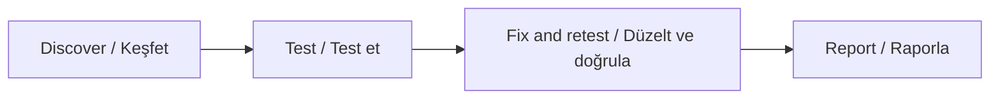

<div align="center">

# Vibe Audit Prompt

### Build fast. Verify with evidence.

AI ile geliştirilen uygulamalar için güvenlik, test ve üretime hazırlık denetimi.

Security, testing, and production readiness reviews for AI-built applications.

[](https://github.com/beratergun/vibe-audit-prompt/actions/workflows/validate.yml)
[](LICENSE)
[](#start--başla)
[](#coverage--kapsam)

**24 domains · 144 baseline controls · 2 standalone prompts · 8 audit reports**

**24 alan · 144 temel kontrol · 2 bağımsız prompt · 8 denetim raporu**

[Türkçe](#türkçe) · [English](#english) · [Kapsam / Coverage](#coverage--kapsam) · [Kaynaklar / Sources](docs/SOURCES.md)

</div>

---

## Start / Başla

| Dil / Language | Tam prompt / Complete prompt | Kullanım kılavuzu / Usage guide | Rapor şablonu / Report template |
|---|---|---|---|
| **Türkçe** | **[Türkçe promptu aç](prompts/AUDIT_PROMPT.tr.md)** | [Türkçe kılavuz](README.tr.md) | [Türkçe şablon](templates/REPORT_TEMPLATE.tr.md) |
| **English** | **[Open the English prompt](prompts/AUDIT_PROMPT.en.md)** | [English guide](README.en.md) | [English template](templates/REPORT_TEMPLATE.en.md) |

## Türkçe

### Ne işe yarar?

Vibe Audit Prompt, AI ile geliştirdiğin web sitesi, SaaS, API, mobil uygulama, masaüstü uygulama veya PWA'yı sistemli biçimde inceletmek için hazırlanmış, tekrar kullanılabilir bir denetim görevidir.

Kaynak koduna ve terminale erişebilen bir kodlama ajanına verildiğinde; projenin mimarisini keşfetmesini, mevcut testleri incelemesini, güvenlik ve işlev sorunlarını araştırmasını, bulguları kanıtlamasını ve yetkili güvenli düzeltmeleri tekrar test etmesini ister. Kapsam, projenin gerçek özelliklerine göre genişler; uygulanmayan maddeler gerekçeleriyle işaretlenir.

**Beklenen sonuç:** hangi kontrolün nasıl değerlendirildiğini, hangi testin gerçekten çalıştığını, neyin düzeltildiğini ve hangi risklerin açık kaldığını gösteren izlenebilir kayıtlar.

### 3 adımda kullan

1. Projeni kaynak kodunu okuyabilen ve terminal komutları çalıştırabilen kodlama ajanında aç.
2. [Türkçe promptun](prompts/AUDIT_PROMPT.tr.md) tamamını görev olarak ver veya projeye kopyalayıp aşağıdaki talimatı kullan.
3. Üretilen raporlarda gerçek test sonuçlarını, doğrulanamayan alanları ve yayın engellerini incele. Sonraki denetimde aynı kontrol ID'leriyle karşılaştır.

```text
prompts/AUDIT_PROMPT.tr.md dosyasının tamamını oku ve bu projede uygula.

Mod: audit-and-safe-fix.
Yerel, izole ve sentetik test ortamını kullan.
Önce mimariyi ve mevcut testlerin başlangıç durumunu keşfet.
Yetkili, geri alınabilir yerel düzeltmeleri yap ve tekrar test et.
Raporları promptta belirtilen yapıda teslim et.
```

Dosyayı farklı yere kopyaladıysan yolu değiştir. Dosyanın projede bulunması tek başına denetim başlatmaz; ajana açık görev ver. Proje kartında ortamı, hedefleri, kritik akışları ve hedef pazarları belirtebilirsin. Parola, token veya gerçek kullanıcı verisi ekleme.

### Çalışma modunu seç

| Mod | Ne yapar? | Ne zaman kullanılır? |
|---|---|---|
| `audit-only` | Uygulama kodunu değiştirmeden inceleme, güvenli test ve raporlama. | İlk değerlendirmeyi görmek istediğinde. |
| `audit-and-safe-fix` | Doğrulanmış sorunlara yetki dahilinde küçük, geri alınabilir yerel düzeltmeler ve tekrar test. | Denetimle birlikte uygun düzeltmeler de istediğinde. Varsayılan mod. |
| `retest` | Önceki bulguları ve etkilenen alanlardaki regresyonları yeniden doğrulama. | Düzeltmelerden sonra kapanış kontrolünde. |

Üretim değişiklikleri, gerçek ödemeler, kimlik bilgisi rotasyonu, veri göçleri ve yayın işlemleri mevcut yetki kapsamında ayrıca değerlendirilir. Yerel düzeltme, canlı ortamın güncellendiği anlamına gelmez.

### Temel kurallar

- **Kanıt:** commit/dosya konumu, beklenen ve gözlenen davranış, yöntem ve test kayıtları istenir.
- **Dürüst sonuç:** çalışmayan, engellenen ve hiç çalıştırılmayan testler geçti gösterilmez.
- **Yetki matrisi:** anonim kullanıcı, farklı kullanıcılar, tenant'lar ve roller arasında API sınırları sınanır.
- **Düzeltme ve regresyon:** sorun → kök neden → düzeltme → tekrar test → etkilenen akışlar izlenir.
- **Proje koruması:** kullanıcı değişiklikleri, gerçek veriler, sırlar ve mevcut işlevler korunur.
- **Hukuki uygulanabilirlik:** KVKK/GDPR, ticari ileti, abonelik ve lisans konuları gerçek pazar/veri akışına göre incelenir.
- **Devam kaydı:** büyük projede tamamlanan kontroller, kanıtlar ve kalan işler AUDIT_STATE.md ile saklanır.

### Sonuçları doğru oku

Bu paket kendi başına çalışan bir güvenlik tarayıcısı değildir. Ajanı inceleme ve gerçek test yürütmeye yönlendirir; sonuç, mevcut araçlara, erişime ve uygulanan doğrulamaya bağlıdır. Belge paketinin otomatik kontrollerinin geçmesi, uygulamanın güvenlik testlerinin geçtiği anlamına gelmez.

Bir prompt bütün açıkların bulunmasını, hatasız çalışmayı veya hukuki uygunluğu garanti edemez. Kritik sınırın testi eksikse yüksek PASS oranı yeterli değildir. Hukuki başlıklar teknik kanıt ve uzman incelemesi için somut sorular üretir.

## English

### What does it do?

Vibe Audit Prompt is a reusable audit task for systematically reviewing AI-built websites, SaaS products, APIs, mobile applications, desktop applications, and PWAs.

Give it to a coding agent with source and terminal access. It asks the agent to discover the architecture, inspect existing tests, investigate security and functional defects, establish evidence, implement authorized safe fixes, and retest. Extend the baseline for actual project features; mark inapplicable controls with reasons.

**Expected outcome:** traceable records showing how controls were assessed, which tests actually ran, what was fixed, and which risks remain unresolved.

### Start in 3 steps

1. Open the project in a coding agent that can inspect source and execute terminal commands.
2. Supply the entire [English prompt](prompts/AUDIT_PROMPT.en.md), or copy it into the project and use the instruction below.
3. Review actual test outcomes, unverified areas, and release blockers. Compare future runs using the same control IDs.

```text
Read and apply the entire prompts/AUDIT_PROMPT.en.md file to this project.

Mode: audit-and-safe-fix.
Use isolated local synthetic test environments.
Discover the architecture and existing test baseline first.
Implement authorized reversible local fixes and retest them.
Deliver reports in the structure required by the prompt.
```

Adjust the path if you copied the file elsewhere. Merely placing a file in the project does not initiate an audit; give an explicit task. Use the project configuration for environments, targets, critical journeys, and markets. Never supply passwords, tokens, or real user data.

### Choose a mode

| Mode | Behavior | When to use it |
|---|---|---|
| `audit-only` | Review, safe testing, and reporting without application code changes. | Initial assessment before remediation. |
| `audit-and-safe-fix` | Minimal, authorized, reversible local fixes for confirmed issues, followed by retesting. | Assessment plus appropriate remediation. The default. |
| `retest` | Reverify previous findings and regressions in affected areas. | Closure checks after fixes. |

Production changes, real payments, credential rotation, migrations, and publishing require appropriate existing authority or separate approval. A local fix does not establish that production was updated.

### Core principles

- **Evidence:** commit/file locations, expected versus observed behavior, methods, and execution records.
- **Honest states:** blocked, failed, and unexecuted tests cannot be reported as passed.
- **Adversarial identities:** exercise API boundaries across anonymous users, peers, tenants, and privilege levels.
- **Remediation and regression:** trace the issue, root cause, patch, retest, and affected journeys.
- **Project protection:** preserve user changes, real data, secrets, and existing functionality.
- **Legal applicability:** assess privacy, messaging, subscriptions, and licensing using actual markets and data flows.
- **Continuity:** preserve completed controls, evidence, and next steps in AUDIT_STATE.md for large projects.

### Interpret the outcome correctly

This pack is not a standalone security scanner. It directs an agent to review and execute real tests; results depend on available tools, access, and verification. Passing this repository's documentation checks does not mean an application's security tests passed.

No prompt guarantees discovery of every vulnerability, defect-free operation, or legal compliance. A high pass rate cannot offset missing verification of a critical boundary. Legal sections produce technical evidence and concrete questions for expert review.

## Coverage / Kapsam

Her alan 6 temel kontrol içerir. ID'ler iki dilde aynıdır; projeye özgü kontroller EXT kimlikleriyle eklenir. / Each domain contains 6 baseline controls. IDs match across languages; add project-specific EXT controls.

| ID | Türkçe | English |
|---|---|---|
| SCOPE | Kapsam, mimari ve başlangıç durumu | Scope, architecture, and baseline |
| SECRET | Sırlar ve kimlik bilgileri | Secrets and credentials |
| AUTHN | Kimlik doğrulama ve hesap kurtarma | Authentication and account recovery |
| SESSION | Oturum ve token yaşam döngüsü | Sessions and token lifecycle |
| AUTHZ | Yetkilendirme ve tenant izolasyonu | Authorization and tenant isolation |
| INPUT | Girdi doğrulama ve enjeksiyon | Input validation and injection |
| WEB | Tarayıcı, XSS, CORS ve cache | Browser security, XSS, CORS, and caching |
| API | API, GraphQL, WebSocket ve webhook | APIs, GraphQL, WebSockets, and webhooks |
| DATA | Veritabanı, RLS ve veri bütünlüğü | Databases, RLS, and data integrity |
| FILE | Dosya yükleme ve nesne depolama | Uploads and object storage |
| LOGIC | İş mantığı, yarış ve idempotency | Business logic, races, and idempotency |
| PAY | Ödeme, abonelik ve haklar | Payments, subscriptions, and entitlements |
| NET | SSRF ve dış servis sınırları | SSRF and outbound service boundaries |
| ABUSE | Hız, kaynak, kota ve maliyet | Rate, resource, quota, and cost limits |
| DEP | Bağımlılıklar ve tedarik zinciri | Dependencies and supply chains |
| CICD | CI/CD, skill, MCP ve ajan izinleri | CI/CD, skills, MCP, and agent permissions |
| INFRA | Altyapı ve üretim yapılandırması | Infrastructure and production configuration |
| OPS | Log, olay müdahalesi ve kurtarma | Logging, incident response, and recovery |
| AI | LLM, RAG ve araç kullanan ajanlar | LLMs, RAG, and tool-using agents |
| PRIV | Gizlilik ve veri yaşam döngüsü | Privacy and data lifecycle |
| LEGAL | Hukuk, tüketici ve içerik hakları | Legal review, consumers, and content rights |
| MOBILE | Mobil, masaüstü ve PWA | Mobile, desktop, and PWA |
| QUALITY | İşlev, erişilebilirlik ve ürün kalitesi | Functionality, accessibility, and quality |
| VERIFY | Performans, güvenilirlik ve doğrulama | Performance, reliability, and verification |

Tam maddeler / Full controls: [Türkçe](prompts/AUDIT_PROMPT.tr.md) · [English](prompts/AUDIT_PROMPT.en.md) · [Ortak katalog / Shared catalog](data/controls.json).

## Audit flow / Denetim akışı



## Evidence and outcomes / Kanıt ve sonuçlar

| Status | Türkçe | English |
|---|---|---|
| `PASS` | Belirtilen kapsam/yöntemde kontrolü destekleyen kanıt var. | Evidence supports the control within the stated scope/method. |
| `FAIL` | Beklenen kontrol sağlanmıyor; kanıt ve bulgu referansı var. | A control is violated, with evidence and a finding reference. |
| `BLOCKED` | Erişim, ortam veya araç engeli var. | Verification is blocked by access, environment, or tooling. |
| `NOT_EXECUTED` | Uygulanabilir test çalıştırılmadı; sebebi açıklanmalı. | An applicable test was not run; explain why. |
| `NOT_APPLICABLE` | Konu uygulanmıyor; gerekçesi gerekli. | The control does not apply; explain why. |
| `MANUAL_REVIEW` | İnsan, panel, cihaz veya hukukçu incelemesi gerekiyor. | A human, dashboard, device, or counsel review is required. |

`STATIC` inceleme ile `DYNAMIC_LOCAL` / `DYNAMIC_STAGING` yürütme ayrıca kaydedilir. / Static review and dynamic execution are recorded separately.

Yayın kararları / Release assessments:

- **BLOCKED:** açık yayın engeli veya kritik doğrulama eksiği / unresolved blocker or missing critical verification.
- **CONDITIONAL:** gerekli koşulları tanımlı, sınırlı kalan işler / limited remaining work with explicit conditions.
- **READY_WITHIN_SCOPE:** belirtilen kapsamda zorunlu doğrulamalar tamam / required verification complete within the stated scope.

## Deliverables / Teslim edilen raporlar

Raporlar ajan tarafından gerçek denetimde oluşturulur; şablonlar tamamlanmış denetim değildir. / The agent creates reports during an actual audit; templates are not completed assessments.

| Report | İçerik / Purpose |
|---|---|
| `SECURITY_MASTER_REPORT.md` | Ana değerlendirme, kapsam, tehdit modeli ve yayın kararı / assessment, scope, threat model, release decision |
| `CONTROL_MATRIX.md` | Bütün kontroller, durumlar ve kanıtlar / all controls, statuses, and evidence |
| `VULNERABILITY_REGISTER.md` | Benzersiz bulgular, etki ve öncelikler / unique findings, impact, and priorities |
| `TEST_RESULTS.md` | Gerçek komutlar, sürümler, sonuçlar ve engeller / commands, versions, results, and blockers |
| `REMEDIATION_REPORT.md` | Düzeltmeler, regresyon ve geri dönüş / fixes, regressions, and rollback |
| `PRIVACY_LEGAL_REVIEW.md` | Veri akışı, uygulanabilirlik ve uzman soruları / data flows, applicability, expert questions |
| `TOOL_REVIEW.md` | Araç kökeni, izinler ve veri çıkışı / tool provenance, permissions, and egress |
| `NEXT_ACTIONS.md` | Öncelikli işler, sahipler ve kabul ölçütleri / priorities, owners, and acceptance criteria |

## Research and attribution / Araştırma ve atıf

Araştırma temeli / Research baseline: **2026-11-01**.

İstenen sekiz kaynak değerlendirildi; resmî güvenlik ve hukuk referanslarıyla birlikte erişim yöntemi ve sınırlamaları kaynak günlüğünde açıklandı. Kontrol kataloğu özgün yazıldı; haricî makaleler, skill kodu ve değerlendirme fixture'ları dağıtılmaz.

All eight requested sources were reviewed. The source ledger records access methods, official references, and limitations. The catalog is original; third-party articles, skill code, and evaluation fixtures are not bundled.

- [Kaynak günlüğü / Source ledger](docs/SOURCES.md)
- [vibe-check ve CodeBaseHub incelemesi / Third-party review](docs/THIRD_PARTY_REVIEW.md)
- [Güvenlik bildirimleri / Security reporting](SECURITY.md)
- [Katkı ve bakım / Contribution and maintenance](CONTRIBUTING.md)
- [Sürüm geçmişi / Changelog](CHANGELOG.md)

## Validate this pack / Bu paketi doğrula

Node.js 20+ ile, ek paket kurmadan / With Node.js 20+, without installing dependencies:

```sh
node scripts/check.mjs
node --test scripts/check.test.mjs
```

Kontroller katalog bütünlüğünü, iki dildeki eşleşmeyi, gerekli dosyaları, yerel bağlantıları ve doğrulayıcının hata senaryolarını sınar. Uygulamanızın güvenlik testlerini çalıştırmaz. / These checks validate catalog integrity, language parity, required files, local links, and validator failure cases. They do not execute your application's security tests. [Doğrulama kapsamı / Validation scope](docs/VALIDATION.md).

## Repository map / Dosya düzeni

```text
vibe-audit-prompt/
├── README.md                 Bilingual project overview
├── README.tr.md              Türkçe ayrıntılı kullanım
├── README.en.md              Detailed English guide
├── prompts/                  Complete standalone TR and EN prompts
├── data/controls.json        Shared bilingual control catalog
├── templates/                TR and EN audit report skeletons
├── docs/                     Sources, tool review, validation limits
├── scripts/                  Dependency-free consistency checks
└── .github/workflows/        Automated documentation validation
```

## License / Lisans

**MIT — kullan, uyarla ve paylaş; lisans bildirimini koru. / Use, adapt, and share; preserve the license notice.**

Üçüncü taraf eserler ve markalar kendi haklarına tabidir. / Third-party works and trademarks remain separately governed. [Full license / Tam lisans](LICENSE).
